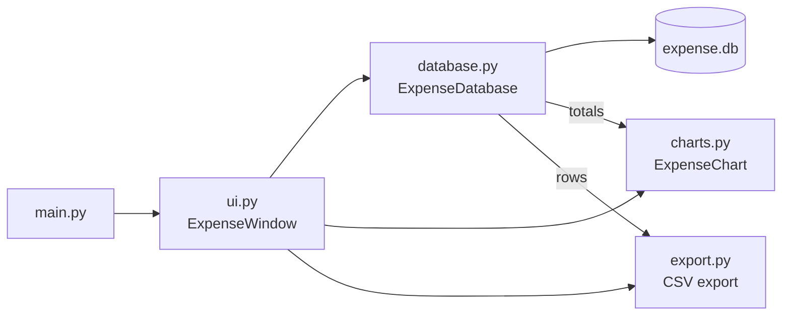

# Expense Tracker

A desktop expense tracker built with Python, PyQt6 and SQLite. Add, edit, search and delete expenses, see your totals at a glance, view category and monthly charts, and export everything to CSV.


<!-- Add a screenshot of the main window and a chart here:

-->

## Table of Contents

- [Features](#features)
- [Project Structure](#project-structure)
- [How It Works](#how-it-works)
- [Requirements](#requirements)
- [Installation](#installation)
- [Usage](#usage)
- [Data Storage](#data-storage)
- [Limitations](#limitations)
- [Roadmap](#roadmap)
- [Contributing](#contributing)
- [License](#license)

## Features

- **Full expense management:** add, edit and delete entries with a title, amount, category, date and notes
- **Dashboard cards:** total spent, spent this month, and number of transactions
- **Search:** find expenses by title, category or notes
- **Charts:** category breakdown (pie chart) and month-by-month totals (bar chart), drawn with Matplotlib
- **CSV export:** save all expenses to a spreadsheet-friendly file
- **Local storage:** everything is saved in a SQLite database on your machine
- **Categories:** Food, Travel, Shopping, Bills, Health, Entertainment, Others
- Dark-themed interface with a calendar date picker

## Project Structure

```text
expense-tracker/
├── main.py            # Application entry point
├── ui.py              # Main window and add/edit dialog (PyQt6)
├── database.py        # SQLite operations (ExpenseDatabase class)
├── charts.py          # Pie and monthly bar charts (Matplotlib in a Qt widget)
├── export.py          # CSV export
├── requirements.txt   # Python dependencies
└── expense.db         # SQLite database (created on first run)
```

## How It Works



1. `main.py` starts the Qt application and opens `ExpenseWindow`.
2. The window loads all expenses from SQLite and fills the table and dashboard cards.
3. Add, edit and delete actions write to the database and then refresh the table.
4. The chart buttons ask the database for category or monthly totals and display them in a separate window.
5. **Export CSV** writes all stored expenses to a file.

## Requirements

- Python 3.8+
- [PyQt6](https://pypi.org/project/PyQt6/)
- [Matplotlib](https://pypi.org/project/matplotlib/)

SQLite support (`sqlite3`) is built into Python. All dependencies are listed in `requirements.txt`.

## Installation

```bash
git clone https://github.com/rudradevil619-byte/expense-tracker.git
cd expense-tracker
python -m venv .venv
```

Activate the virtual environment:

```bash
# Linux/macOS
source .venv/bin/activate

# Windows
.venv\Scripts\activate
```

Install dependencies:

```bash
pip install -r requirements.txt
```

## Usage

Run the app from the project folder:

```bash
python main.py
```

| Action | How |
| --- | --- |
| Add an expense | Click **Add**, fill in the form and click **Save** |
| Edit an expense | Select a row, click **Edit**, change the details and click **Save** |
| Delete an expense | Select a row, click **Delete** and confirm |
| Search | Type a keyword and click **Search** (clear the box and search again to show everything) |
| Category chart | Click **Pie Chart** |
| Monthly chart | Click **Monthly Chart** |
| Export | Click **Export CSV** |

## Data Storage

Expenses are stored in a SQLite file named `expense.db`, created in the folder you run the app from. Each record has an ID, title, amount, category, date (`YYYY-MM-DD`) and optional notes.

Back up `expense.db` to keep your history. Deleting it starts you off with an empty tracker.

## Limitations

- The currency symbol is fixed to `$`.
- Search filters the table only. The dashboard cards always show totals for all expenses.
- There is no input validation, so an entry with an empty title or a zero amount can be saved.
- The database path is relative, so run `python main.py` from the project folder.
- Categories are hard-coded in `ui.py`.

## Roadmap

- [ ] Configurable currency symbol
- [ ] Input validation for title and amount
- [ ] Custom categories
- [ ] Filter by date range and category
- [ ] Budget limits and monthly budget alerts
- [ ] Sortable table columns
- [ ] Import from CSV
- [ ] Unit tests for `database.py`
- [ ] Package as a Windows executable with PyInstaller

## Contributing

Issues and pull requests are welcome. For larger changes, please open an issue first to discuss what you would like to change.

## License

This project is licensed under the MIT License. See the `LICENSE` file for details.
